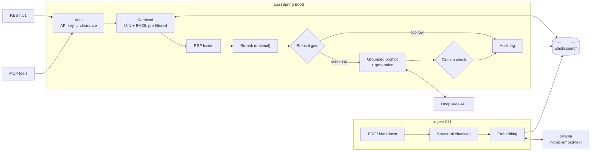

# Bank Policy Knowledge RAG Service

> **Status: in progress.** Nothing below is implemented yet unless the
> [roadmap](ROADMAP.md#progress) says so.

A production-shaped retrieval-augmented generation (RAG) service over banking supervisory
guidance and fictional internal bank policies. The focus is on being measurable and
controllable, not on a chat UI.

## What it does

- **Grounded answers with precise citations.** Every citation resolves to a chunk and the
  paragraph number in its source document.
- **Refuses when retrieval is weak** instead of letting the model improvise.
- **Permission filtering at retrieval time.** Documents are classified
  `public` < `internal` < `restricted`. The filter runs as an Elasticsearch pre-filter, not
  as a prompt instruction.
- **Replayable audit log.** Every answer stores its full prompt, model parameters and
  retrieved chunk hashes.
- **Eval-gated CI.** Retrieval metrics (Recall@5, MRR) are compared against a committed
  baseline on every PR.
- **MCP server.** Exposes `search_docs`, `answer_question` and `get_section` for other agents.

## Architecture (planned)



| Layer | Choice |
|---|---|
| Language / framework | Java 25, Spring Boot 4.x, Spring AI (chat, embedding, MCP only) |
| Search | Elasticsearch: `dense_vector` HNSW + BM25, RRF fused in the application layer |
| Embedding | Ollama `nomic-embed-text` (ablation with `bge-small-en-v1.5`, `bge-m3`) |
| Generation / judge | DeepSeek, switchable to a local Ollama model |
| Testing | JUnit 5, Testcontainers |

Modules: `core/` (plain Java: parsing, chunking, RRF, citation validation, metrics),
`app/` (Spring Boot: REST, MCP, security, ES, ingest CLI), `eval-runner/`.

See [ROADMAP.md](ROADMAP.md) for the full design, API contract and data model.

## Corpus

The corpus has two parts:

1. **Public:** selected modules of the HKMA Supervisory Policy Manual (SPM), e.g. TM-G-1,
   TM-G-2, OR-1, OR-2, SA-2. **These files are not included in this repository** and must be
   downloaded by you.
2. **Fictional:** internal policy documents of "Example Bank", in `corpus/internal/`, plus
   adversarial samples for prompt injection testing in `corpus/adversarial/`.

### Getting the SPM files

1. Visit the Supervisory Policy Manual section of the Hong Kong Monetary Authority's
   official website.
2. Download the PDF of each module listed in `corpus/manifest.yaml`, at the version and
   revision date listed there.
3. Save each one in `corpus/raw/` (gitignored) under the `file` name given in the manifest,
   e.g. `corpus/raw/OR-2.pdf`. Do not modify the files.
4. Run `scripts/verify-corpus.sh` to check their sha256 hashes against the manifest
   (`--print` shows the computed hashes).

Use of the SPM is subject to the HKMA website terms of use (non-commercial use, unmodified,
with attribution). Do not redistribute the PDFs or any text extracted from them.

## Local setup

Prerequisites:
- Linux arm64 or x86_64, Docker with Compose v2, JDK 25
- Elasticsearch needs `vm.max_map_count >= 262144`:

  ```sh
  echo 'vm.max_map_count=262144' | sudo tee /etc/sysctl.d/99-elasticsearch.conf
  sudo sysctl --system
  ```

Steps:

```sh
cp .env.example .env            # fill in ES_PASSWORD, DEEPSEEK_API_KEY, RAG_KEY_DEV
docker compose up -d            # Elasticsearch + Ollama (skip if you already run both)
docker compose exec ollama ollama pull nomic-embed-text
set -a; . ./.env; set +a
./gradlew :app:bootRun --args="ingest --step=embed"   # embeddings into .cache/ (gitignored)
./gradlew :app:bootRun --args="ingest --step=index"   # bulk-write the chunks index
./gradlew :app:bootRun                                # REST API on :8080
./gradlew :eval-runner:run --args="--base-url=http://127.0.0.1:8080"
```

`ingest` without `--step` runs both steps; add `--recreate` to rebuild an existing index.
`compose.yaml` matches the author's shared Elasticsearch and Ollama stacks (same images and
limits); with your own Elasticsearch, point `ES_URL` at it.

## Evaluation results

| Phase | Configuration | Recall@5 | MRR | nDCG@10 | Notes |
|---|---|---|---|---|---|
| 1 | VECTOR, fixed 512/64 chunks, `nomic-embed-text` | 0.850 | 0.833 | 0.792 | `test` split, n = 10; [report](evidence/phase1-baseline.md) |

Numbers come only from eval runner output; reports live in `evidence/`.

## Attribution and disclaimer

Source: Hong Kong Monetary Authority, Supervisory Policy Manual.

Not affiliated with or endorsed by the HKMA. Not legal or regulatory advice.

"Example Bank" and all of its documents are fictional.
