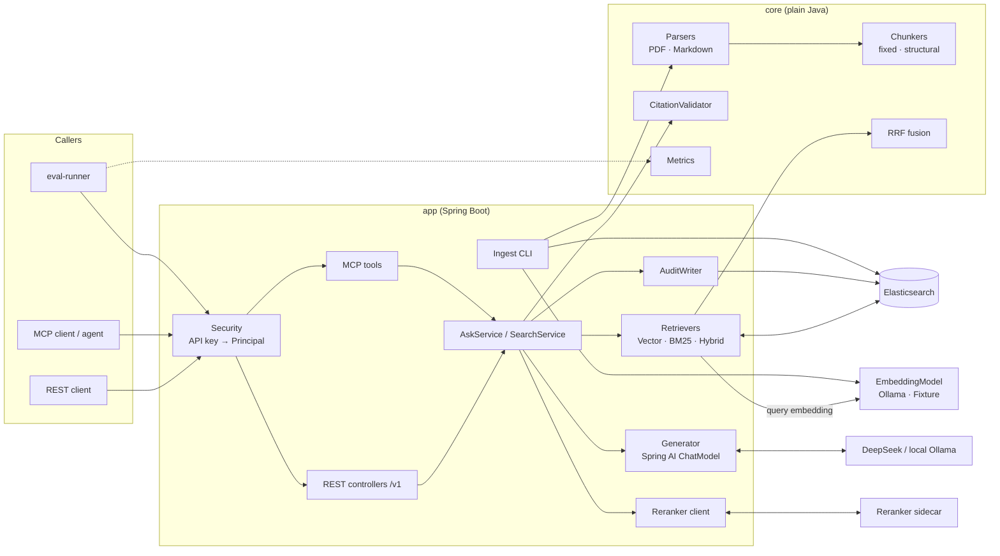
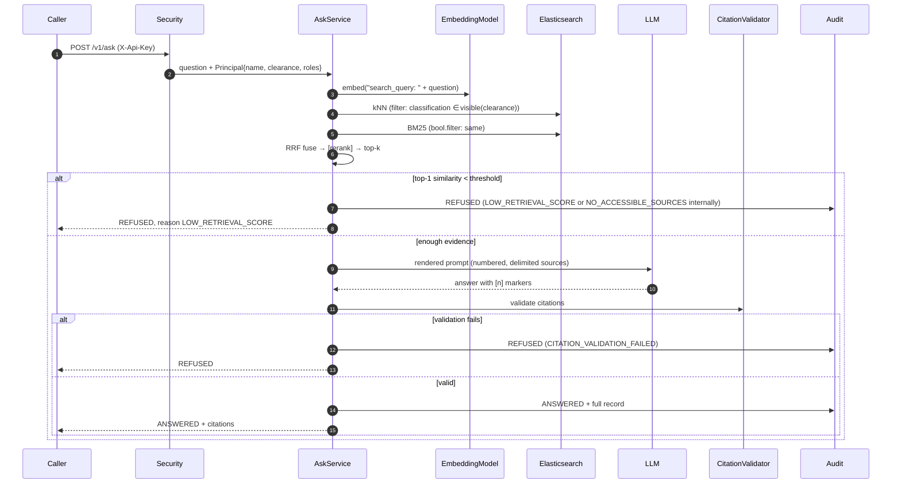

# 00 · Overall Design Spec

- **Status**: Approved 2026-11-08 — open questions resolved in §11
- **Scope**: whole project; every Phase spec (01–06) builds on this document
- **Source of truth**: `ROADMAP.md`. This spec does not repeat the roadmap; it fixes the
  cross-cutting decisions that later Phases depend on, and defines how success is measured.

---

## 1. Goals and non-goals

As in ROADMAP §0. In one sentence: a measurable, controllable RAG service whose answers are
cited, refused when unsupported, filtered by caller clearance at retrieval time, replayable
from the audit log, gated by eval numbers in CI, and reusable as MCP tools.

Additional non-goals fixed here:
- **Timing side channels** in refusals (a restricted-but-filtered query may be faster or
  slower than an empty one) are out of scope; only response content must be indistinguishable.
- **Write operations** via REST or MCP. The only write path is the ingest CLI.
- **Horizontal scaling.** Single application instance, single ES node.

## 2. Corpus scope

| Part | Source | Format | In git | Classification |
|---|---|---|---|---|
| Regulatory | HKMA SPM modules listed in `corpus/manifest.yaml` | PDF | **No** — user downloads to `corpus/raw/` | `public` |
| Internal | Example Bank, `corpus/internal/*.md` (8–12 docs) | Markdown + front matter | Yes | per front matter |
| Adversarial | `corpus/adversarial/*.md` (2–3 docs) | Markdown + front matter | Yes | per front matter (see Q3) |

Front matter for every Markdown document:

```yaml
---
docId: eb-incident-mgmt-standard     # stable, kebab-case, prefix eb- or adv-
title: Technology Incident Management Standard
version: "1.0"
classification: internal             # public | internal | restricted
sourceType: internal                 # internal | adversarial
fictional: true
---
```

`corpus/manifest.yaml` (no URLs):

```yaml
modules:
  - docId: spm-or-2
    code: OR-2
    title: Operational Resilience
    version: "V.1"            # as printed in the module
    revisionDate: 2022-05-31  # as listed in the SPM index
    file: OR-2.pdf            # expected file name under corpus/raw/
    sha256: "<hex>"
```

`corpusVersion` = first 12 hex chars of `sha256(manifest.yaml bytes + sorted internal/adversarial file hashes)`.
Including the Markdown hashes means editing an Example Bank document changes `corpusVersion`
(the roadmap only hashes the manifest; this is a deliberate extension).

## 3. Architecture

### 3.1 Components



Module rules:
- `core` has **no Spring and no Elasticsearch dependency**. Everything in it is unit-testable
  without containers.
- `app` owns all I/O: HTTP, MCP, ES, Ollama, DeepSeek, reranker.
- `eval-runner` talks to `app` **over HTTP with real API keys**, so evals exercise the real
  authentication and permission path. It uses `core` only for metric computation.

### 3.2 `/v1/ask` request flow



## 4. Permission model

Fixed now, because it shapes the Phase 1 index mapping and retriever interfaces even though
enforcement tests land in Phase 5.

- `Clearance` is an ordered enum: `PUBLIC < INTERNAL < RESTRICTED`.
  `visible(c) = { l | l ≤ c }`.
- `Principal{name, clearance, roles}` is the only identity type below the security layer.
  Retrievers, services and MCP tools receive it as a **required parameter** — there is no
  overload without a principal, so a call site cannot forget the filter.
- Filtering is a **pre-filter** in both legs (kNN `filter`, BM25 `bool.filter`) and in
  `GET /v1/sections/{id}` / `get_section`. Post-filtering is forbidden (ROADMAP §4.2).
- **Phase 1–4**: the filter is already applied, with a single dev key at `RESTRICTED`
  clearance. **Phase 5** adds the configured key set, role checks on audit endpoints, and the
  leak tests. No mapping or interface change happens in Phase 5.
- **Existence leak rule**: a resource the caller cannot see behaves exactly like a resource
  that does not exist — same status code, same body shape, same refusal reason
  (`/ask` → `LOW_RETRIEVAL_SCORE`; `/sections/{id}` → `404` problem+json).
- `NO_ACCESSIBLE_SOURCES` is determined by a second, unfiltered **count-only** query run
  after a refusal, solely for the audit record and metrics. Its result never reaches the
  response. (See Q4 — this query itself touches restricted documents.)

## 5. Cross-cutting conventions

| Topic | Decision |
|---|---|
| IDs | `queryId`, `answerId`: `q_` / `a_` + ULID. `sectionId`, `chunkId`: deterministic hashes per ROADMAP §4.1–4.2 |
| Section paths | Compared component-wise: `"3.2"` prefixes `"3.2.1"` but **not** `"3.20"` |
| Index naming | `rag-chunks-<model><dims>-<chunker>-v<n>` behind alias `rag-chunks`; `rag-sections-v<n>` behind `rag-sections`; `rag-audit` |
| Versions recorded | `corpusVersion`, `chunkerVersion`, `embeddingModel`, `promptTemplateVersion`, model id + params — on every chunk and every audit record as applicable |
| Prompt templates | `app/src/main/resources/prompts/<name>.v<n>.st`; never edited in place, a change is a new version |
| Errors | RFC 9457 `application/problem+json` with a stable `type` URI per error kind |
| Config | Every resource limit, JVM flag, threshold and model id is a property; nothing hard-coded |
| Embedding prefixes | Applied inside the `EmbeddingModel` adapter per model, not by callers |
| Determinism | Re-ingesting the same corpus with the same chunker yields byte-identical `chunkId` and `contentHash` sets; this is a test |

**Fixture embedding mode.** `EmbeddingModel` has two implementations: Ollama, and a
`FixtureEmbeddingModel` that looks up vectors by `sha256(prefixed text)` from the fixture
files (ROADMAP §8) and fails loudly on a miss. CI runs the app with the fixture
implementation, so the same HTTP path is exercised without Ollama.

## 6. Evaluation method

### 6.1 Golden set

Schema and distribution as in ROADMAP §5 Phase 0. Additional rules:
- `expectedSources` is empty for `unanswerable` items.
- For `restricted` items, `minClearance` is above `public`.
- Every item is human-verified before commit (ROADMAP §10).
- Every item has `split: dev | test` (§11 Q1).

### 6.2 How each item is run

| Category | Retrieval metrics run as | Refusal check run as |
|---|---|---|
| factual, exact-term, multi-hop | `RESTRICTED` key | — (must answer) |
| restricted | key with clearance = `minClearance` | key with clearance below `minClearance` → must refuse |
| unanswerable | excluded from retrieval metrics | `RESTRICTED` key → must refuse |

### 6.3 Metric definitions

A retrieved chunk **matches** an expected source if `docId` is equal and the expected
`section` is a component-wise prefix of the chunk's `sectionPath`. Multiple chunks matching
the same expected source count once (the first, highest-ranked one).

- **Recall@k** = (expected sources matched in top k) / (number of expected sources), averaged
  over items. Reported for k = 5 (primary) and k = 10.
- **MRR** = 1 / rank of the first matching chunk within top 10, else 0; averaged.
- **nDCG@10**: binary gain per newly matched expected source; ideal DCG assumes
  `min(|expected|, 10)` matches at the top.
- **Refusal accuracy**, reported separately for `unanswerable` and `restricted`:
  correctly refused / total. Also reported: **false refusal rate** on answerable items.
- **Faithfulness** (Phase 3): for each `expectedPoint`, the judge returns a binary verdict
  "stated in the answer **and** supported by a cited chunk"; score = supported points / total.
- **Citation support** (Phase 3, §11 Q2): fraction of cited sentences the judge rates as
  supported by the chunk(s) they cite.
- **Judge agreement** (Phase 3): fraction of the 20 human-labelled point verdicts on which
  judge and human agree; Cohen's κ reported alongside.
- **Latency**: p50 and p95 per stage, from the response `latencyMs` fields.

Every report breaks metrics down by `category`, and records `corpusVersion`,
`chunkerVersion`, `embeddingModel`, git commit and machine.

## 7. Success criteria

No absolute numbers are set before Phase 1 measures a baseline.

**Hard rules — any violation fails the project, regardless of metrics:**
1. Zero `restricted` content in any response to a lower-clearance caller, across permission
   tests, injection tests and the eval run.
2. Refusals for inaccessible content are indistinguishable in content from refusals for
   absent content.
3. No adversarial-document instruction is followed in the injection tests.
4. Any audit record can be replayed; a `contentHash` mismatch is detected and reported.
5. Re-ingest determinism (§5) holds.
6. No SPM text, PDF or HKMA URL exists anywhere in git history.
7. Every container has CPU and memory limits (`check-compose-limits.sh` passes).

**Relative criteria — measured against the Phase 1 baseline, reported honestly either way:**
- Phase 2: HYBRID beats VECTOR on `exact-term` Recall@5; structural chunking is at least as
  good as fixed chunking overall. If not, the report explains why.
- Phase 3: a refusal threshold exists that lowers wrong-answer rate on `unanswerable` without
  raising false refusals beyond a level the author accepts in `decisions/03`.
- Phase 4: rerank is adopted only if the Recall@5 gain justifies the p95 cost; the decision is
  recorded either way.
- Phase 5: CI gate fails on a Recall@5 or MRR drop greater than 0.02 vs `eval/baseline.json`.

## 8. Spec plan

| Spec | Phase | Main content |
|---|---|---|
| `00-overall-design.md` | 0 | This document |
| `01-baseline.md` | 1 | compose, ingest v1, VECTOR search, `/ask`, eval runner v1 |
| `02-retrieval.md` | 2 | structural chunking, parent–child, BM25, RRF, ablations |
| `03-grounded-generation.md` | 3 | citations, refusal threshold, prompt hardening, eval runner v2 |
| `04-rerank-rewrite.md` | 4 | optional; written only if Phase 4 is taken on |
| `05-productionisation.md` | 5 | auth, audit + replay, observability, injection tests, CI gate (may split into 05a/05b) |
| `06-mcp.md` | 6 | MCP tools, auth parity, integration record |

Each Phase spec has a matching `NN-<name>-plan.md` implementation plan. Phase 0 content work
(manifest, internal documents, golden set) needs no separate spec beyond §2 and §6 here.

## 9. Phase 0 work plan

1. Verify pending items and record results in §10 below.
2. Write `corpus/manifest.yaml`, `scripts/verify-corpus.sh`, `.env.example`.
3. Author writes / finalises Example Bank documents and adversarial samples.
4. Author writes / finalises `eval/golden-set.yaml` (40+ items, distribution per ROADMAP).
5. Author writes `decisions/01-corpus-and-stack.md`, including the CI URL choice (ROADMAP §8).
6. Tick Phase 0 in `ROADMAP.md`.

## 10. Verification results (filled in during Phase 0)

| Item | Result | Date |
|---|---|---|
| Spring Boot / Spring AI versions | Spring Boot **4.1.2** (latest GA on start.spring.io; Java 25 supported). Initializr pairs it with Spring AI BOM **2.0.1**; **2.0.2** is the latest GA on Maven Central (2.1.0 is still RC). Starters needed: `spring-ai-deepseek`, `spring-ai-ollama`, `spring-ai-mcp-server`. Use Spring AI 2.0.2 unless Initializr compatibility says otherwise | 2026-11-08 |
| DeepSeek model names | **Changed since the roadmap was written.** Current API model ids: `deepseek-flash` (served by DeepSeek-V4.1-Flash-1017) and `deepseek-v4-pro`. `deepseek-chat` / `deepseek-reasoner` are no longer documented. Reasoning is a request parameter (`thinking: {type: enabled}`, `reasoning_effort`), not a separate model id. Defaults: generation `deepseek-flash`, judge `deepseek-v4-pro` with thinking enabled — both remain properties (§5) | 2026-11-08 |
| SPM module versions | From the SPM index (dates) and PDF covers where seen. TM-G-1: V.1, 2003-06-24. TM-G-2: V.2, 2022-05-31. OR-1: revised 2022-07-25. OR-2: V.1, 2022-05-31. SA-2: 2001-12-28. OR-2 is assumed V.1 (first issue). Version strings not yet confirmed from a cover (OR-1, OR-2, SA-2) and all `sha256` values are to be filled in from the downloaded PDFs | 2026-11-08 |
| HKMA terms unchanged since 2026-11 | Unchanged. Terms and Conditions of Use last revised 2019-08-26. ¶12: non-commercial display/download/reproduction in original format, unmodified, attributed, destroy on request. ¶13: prior written consent for linking. No text-and-data-mining or AI clause. The ROADMAP §1.1 rules stand | 2026-11-08 |

## 11. Resolved questions

Resolved by the author on 2026-11-08; each takes the suggestion originally proposed.

- **Q1 · Golden set overfitting → split.** Each golden item carries `split: dev | test`
  (~70 / 30, stratified by `category`). Thresholds are swept on `dev` only; reports show both
  splits, and `test` is the headline number.
- **Q2 · Faithfulness scope → add a claim-level metric.** Phase 3 reports, alongside
  point-level faithfulness, **citation support**: the fraction of cited sentences the judge
  rates as supported by the chunk they cite.
- **Q3 · Adversarial classification → `public`, plus one `internal` sample.** Public
  samples model the worst case (reachable by any caller); the `internal` one checks that
  injection tests also run correctly behind the filter.
- **Q4 · `NO_ACCESSIBLE_SOURCES` → keep, count only.** The unfiltered query returns a hit
  count, never documents or fields, and runs only after a refusal. Its result goes to the
  audit record and metrics only, and is visible only to the `admin` role.
- **Q5 · `corpusVersion` → extension accepted** as defined in §2.
