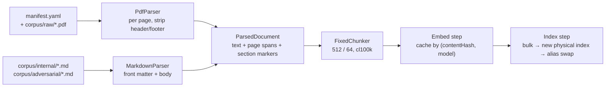

# 01 · Phase 1 Spec: Naive Baseline

- **Status**: Approved 2026-11-08
- **Scope**: ROADMAP §5 Phase 1. Builds on `00-overall-design.md`; does not repeat it.
- **Exit**: `evidence/phase1-baseline.md`, produced from real eval-runner output. The number
  is deliberately not tuned.

---

## 1. What Phase 1 delivers

| # | Deliverable | Notes |
|---|---|---|
| 1 | Gradle multi-module skeleton: `core`, `app`, `eval-runner` | Kotlin DSL, Gradle wrapper, versions pinned (§9) |
| 2 | `compose.yaml` + `scripts/check-compose-limits.sh` | For people running elsewhere; this server uses the shared stacks (§2) |
| 3 | Ingest v1 CLI | PDF + Markdown → fixed chunking → embedding (cached) → `chunks` index |
| 4 | `POST /v1/search` (`VECTOR` only) | Pre-filtered by clearance |
| 5 | `POST /v1/ask` | Vector top-5 → prompt v1 → DeepSeek → answer + numbered sources. No validation, no refusal |
| 6 | API-key authentication, one dev key | `RESTRICTED` clearance (spec 00 §4) |
| 7 | Eval runner v1 | Retrieval only: Recall@5/@10, MRR, nDCG@10; JSON + Markdown |
| 8 | Baseline report | `evidence/phase1-baseline.md` |

**Out of scope** (later Phases): structural chunking, `rag-sections` parent index and
`GET /v1/sections/{id}`, BM25 / HYBRID, citation validation, refusal threshold, audit,
tracing spans, metrics, fixture embedding mode, CI workflow.

## 2. Environment

Verified live on 2026-11-08 against the shared stacks (decisions/01 Decision 5):

| Item | Value |
|---|---|
| Elasticsearch | 9.5.5, `http://127.0.0.1:9200`, plain HTTP, security on |
| ES users | `rag` → `all` on `rag-*`; `rag_dev` → `all` on `rag_dev-*`. Cross access is 403 (tested). Only cluster privilege is `cluster:monitor/main` (`GET /`) |
| Ollama | 0.40.15, `http://127.0.0.1:11434`, no auth, `nomic-embed-text` returns 768 dims |
| Credentials | `APP_RAG_PASSWORD` / `APP_RAG_DEV_PASSWORD` in the gitops ES stack's `.env`; copied by the author into this repo's `.env` as `ES_PASSWORD` |

**Pool selection.** A single property `rag.env-prefix` (`rag_dev` by default, `rag` in the
`prod` profile) names every index and alias. ES username = prefix. **All Phase 1 development
and the baseline run use the `rag_dev` pool.**

**Amendments to spec 00 §5 index naming** (consequence of decisions/01):

| Spec 00 | Now |
|---|---|
| `rag-chunks-<model><dims>-<chunker>-v<n>` behind `rag-chunks` | `<prefix>-chunks-<model><dims>-<chunker>-v<n>` behind `<prefix>-chunks`, e.g. `rag_dev-chunks-nomic768-fixed512-v1` |
| `rag-audit` | `audit-<prefix>-*` (gitops rule). App users get only `create_doc` there; **reads are 403**, so Phase 5's `GET /v1/audit` and replay need a separate read path. Recorded here, solved in spec 05 |

`compose.yaml` in this repo runs `elasticsearch` and `ollama` with the same image tags,
digests and limits as the shared stacks (ROADMAP §7), for people without them. It is not
started on this server. `check-compose-limits.sh` runs `docker compose config --format json`
and fails if any service lacks `deploy.resources.limits.cpus` or `.memory`.

## 3. Ingest v1

CLI: `./gradlew :app:bootRun --args="ingest [--step=all|embed|index] [--recreate]"`.
`embed` fills the cache only; `index` reads only from the cache and fails on a miss. This
is the two-step ingest of ROADMAP §7.1 and covers the "write precomputed vectors" mode of §7.0.

### 3.1 PDF parsing (SPM)

- `verify-corpus.sh` logic is re-checked in Java: a PDF whose sha256 differs from the
  manifest fails ingest.
- PDFBox `PDFTextStripper`, one page at a time, `sortByPosition = true`.
- **Header/footer removal**: within the first 3 and last 3 non-blank lines of each page, a
  line is removed if its digit-normalised form (`\d+` → `#`) occurs in that zone on at least
  60% of the document's pages. A line that is only a number in the last 3 lines is a page
  number and is removed.
- Footnotes are kept as body text (naive baseline).
- Pages are joined with `\n`; the parser records the character range of each page.

### 3.2 Markdown parsing

- YAML front matter is required. `docId`, `title`, `version`, `classification`, `sourceType`
  must be present; a missing or unknown `classification` fails ingest (classification.yaml).
- Body = everything after the front matter. Pages are empty.

### 3.3 Section attribution (used only for metadata, not for chunk boundaries)

Phase 1 chunks are fixed-length, but each chunk still needs section metadata so the golden
set can be scored at all. The parser records **section markers** (character offset + path):

- **SPM**: a body line matching `^\s*(\d+\.|\d+(\.\d+)+)\s+\S` is a marker. Top-level numbers
  need a trailing dot (`2.`), which excludes footnote lines (`1 These…`) and page numbers.
  A marker is accepted only if its path is greater, component-wise, than the previous
  accepted one; this rejects numbers that happen to start a wrapped line.
  **Front matter is not attributed**: every module has a `Structure` contents list that
  restarts at `1.`; markers start at the second `^\s*1\.\s` line after the `Structure` line
  (verified on all five modules). Text before that has an empty section path.
- **Markdown**: headings of the form `#+ <number> <title>` are markers, using the heading
  number chain (`## 2 …` → `["2"]`). Numbered paragraphs inside a heading are not markers
  (matches the golden set's header comment). Text before the first numbered heading has an
  empty section path.

### 3.4 Fixed chunking

- `chunkerVersion = fixed-512-64-cl100k`.
- Text is split into whitespace-delimited words with their character offsets. Words are
  accumulated until the next word would push the window past 512 cl100k tokens (jtokkit).
  The next window starts at the latest word such that the overlap is ≥ 64 tokens.
  Working on words (not decoding token slices) keeps chunks on valid text boundaries and
  gives exact character ranges.
- Chunks never span documents.
- Per chunk:
  - `pages`: pages whose range overlaps the chunk's range.
  - `sectionPath`: path of the marker in effect at the chunk's start (empty if none).
  - **`coveredSections`** (new field): leaf paths of every marker in effect anywhere in the
    chunk's range, e.g. `["2.3", "2.4"]`.
  - `sectionId` = spec 00 rule over `sectionPath`. No `rag-sections` documents exist in Phase 1.
  - `chunkId`, `contentHash`, `tokenCount` per ROADMAP §4.2.
- **Scoring rule for Phase 1** (amends spec 00 §6.3 for fixed chunks): a chunk matches an
  expected source if `docId` is equal and the expected `section` is a component-wise prefix
  of `sectionPath` **or of any entry in `coveredSections`**. Without this, a fixed chunk
  starting mid-section would be scored against the wrong section and the baseline would
  measure the scoring rule rather than retrieval. Phase 2 keeps the same rule, so baselines
  stay comparable.

### 3.5 Embedding and indexing

- `Embedder` interface in `app`, Ollama implementation over Spring AI `EmbeddingModel`.
  Prefixes are added inside the adapter: `search_document: ` / `search_query: `.
  Options: `num_thread` (default 3), batch size (default 16) — both properties.
- Cache: `.cache/embeddings/<model>/<contentHash>.f32` (gitignored). Key is the hash of the
  **unprefixed** chunk content plus model id.
- Mapping per ROADMAP §4.2 plus `coveredSections` (keyword). `number_of_replicas: 0`.
  `dense_vector`: `dims: 768`, `similarity: cosine`, `index_options: {type: hnsw, m: 16,
  ef_construction: 100}` (explicit, no quantisation). Index `_meta` holds
  `corpusVersion`, `chunkerVersion`, `embeddingModel`.
- The physical index name is deterministic. If it exists, ingest fails unless `--recreate`
  (delete, rebuild, then point the alias at it atomically).
- `corpusVersion` = first 12 hex of sha256 over: manifest.yaml bytes, then for each Markdown
  file sorted by repo-relative path, `path + "\n" + sha256hex + "\n"` (spec 00 §2).
- Ingest logs per-step wall time and chunk counts; these go into the evidence report.

## 4. API (Phase 1 subset of ROADMAP §3)

**Authentication**: `X-Api-Key` header, mapped via `rag.security.api-keys` to
`Principal{name, clearance, roles}`. Phase 1 configures one key, `${RAG_KEY_DEV}` →
`dev`, `RESTRICTED`. Missing or unknown key → `401` problem+json. Constant-time comparison.

**`POST /v1/search`** — request/response as ROADMAP §3.2. `mode` defaults to `VECTOR`;
`BM25` / `HYBRID` → `400` problem+json (`type: …/unsupported-mode`). `topK` 1–50, default 5.
`rerank: true` → `400`. Hits add `coveredSections`. `scores` carries `vectorRank` and the raw
`similarity`. kNN: `k = topK`, `num_candidates` property (default 100),
`filter: terms classification ∈ visible(clearance)` — **pre-filter**.

**`POST /v1/ask`** — vector top-5 (same retriever and filter) → `prompts/answer.v1.st` →
DeepSeek → response as ROADMAP §3.3 `ANSWERED` shape. `citations` lists **all retrieved
sources** numbered `[1]…[5]` (no validation in Phase 1). `usage` comes from the API
response. `latencyMs.retrieval` / `.generation` measured; `rerank` = 0. `conversationId`
non-null → `400`. Always `ANSWERED` in Phase 1; zero hits → `ANSWERED` with an answer
saying no sources were found, **without calling the LLM**.

Prompt v1: system message says to answer only from the numbered sources and to cite with
`[n]`; sources follow, each with docId, sectionPath and text. No delimiter hardening yet
(Phase 3). Model `deepseek-flash`, temperature 0, max tokens 1024 — all properties.

**`GET /actuator/info`** exposes `corpusVersion`, `chunkerVersion`, `embeddingModel` read
from the live chunks index `_meta`, so the eval runner can record them. `/actuator/health`
included. Everything else under `/actuator` disabled for now.

Errors: Spring's RFC 9457 support, stable `type` URIs under `urn:rag:problem:<kind>`.

## 5. Eval runner v1

- Separate module, plain Java CLI (no Spring): `./gradlew :eval-runner:run --args="--base-url=… --split=all"`.
  API key from `RAG_KEY_DEV`.
- Loads `eval/golden-set.yaml`, validates schema (fails on unknown category / missing split).
- For every item except `unanswerable`: `POST /v1/search` with `topK=10`, `mode=VECTOR`.
  All items run with the dev key (`RESTRICTED`) — Phase 1 has only that key; the
  per-clearance runs of spec 00 §6.2 start in Phase 5.
- Metrics computed in `core` per spec 00 §6.3, with the §3.4 matching rule: Recall@5,
  Recall@10, MRR (within top 10), nDCG@10. Broken down by `category` and by `split`
  (`test` is the headline). Client-side latency p50 / p95.
- Output: `eval/runs/<UTC timestamp>/report.json` + `report.md` (gitignored). Each report
  records `corpusVersion`, `chunkerVersion`, `embeddingModel` (from `/actuator/info`), git
  commit + dirty flag, machine (`uname -m`, CPU count), and per-item ranks.
- `evidence/phase1-baseline.md` = the generated `report.md` for the baseline run, plus ingest
  timings and a short "observations" section written from those numbers. Per-item rows show
  question id and ranks only — never chunk text (chunks may be SPM text).

## 6. Testing

| Layer | What | How |
|---|---|---|
| `core` unit | Header/footer stripping, page ranges, SPM marker rules (trailing-dot, monotonic, `Structure` skip), Markdown front matter + heading markers, fixed chunker (window/overlap limits, offsets, `coveredSections`), determinism, metrics (hand-computed cases incl. component-wise prefix `3.2` ≠ `3.20`) | JUnit 5. **The test PDF is generated in the test with PDFBox from self-made text** (headers, footers, footnote, Structure list) — no binary fixture, no SPM text |
| `app` integration | Mapping + `_meta`, ingest → alias, `/v1/search` pre-filter (a `PUBLIC` principal never sees `internal` hits even when they are nearest), auth 401, unsupported mode 400, `/v1/ask` request/response with a stub `ChatModel`, zero-hit ask skips the LLM | Testcontainers ES (`elasticsearch:9.5.5` pinned digest, `-Xms512m -Xmx512m`, 1.5 GB, 2 CPUs, security on) + deterministic fake `Embedder` |
| Ollama adapter | Prefixing, 768 dims, `num_thread` passed | Unit test against a stubbed HTTP server; one `@Tag("local")` test against the real local Ollama, excluded by default |
| `eval-runner` | Golden set parsing/validation, report rendering | Unit tests; HTTP client against a stub server |
| Scripts | `check-compose-limits.sh` pass/fail cases | Bash test beside the existing `scripts/tests/` |

The pre-filter test lands now because the filter does (spec 00 §4); the full leak tests are
Phase 5.

## 7. Configuration

All of these are properties with env-var overrides; `.env.example` gains any new variable.

`rag.env-prefix`, `spring.elasticsearch.uris` (`ES_URL`, default `http://127.0.0.1:9200`),
username = prefix, password `ES_PASSWORD`; `rag.embedding.{model, num-thread, batch-size}`;
`rag.retrieval.num-candidates`; `rag.chunking.{max-tokens, overlap-tokens}`;
`spring.ai.deepseek.*` (`DEEPSEEK_API_KEY`, model, temperature, max tokens);
`rag.security.api-keys`. App JVM: `-Xmx1g` in `build.gradle.kts` `bootRun`, overridable.

`.env.example` changes: `ES_URL` default becomes `http://127.0.0.1:9200` (shared ES is plain
HTTP on loopback); add `RAG_ENV_PREFIX`.

## 8. Phase 1 evidence report contents

1. Configuration: chunker, model, `num_candidates`, HNSW params, versions, commit, machine.
2. Ingest: documents, chunks, tokens, embed-step and index-step wall time.
3. Retrieval metrics table: overall and per category, for `test` and `dev`.
4. Latency p50 / p95 of `/v1/search` (client-side; shared ES noise noted).
5. Three `/v1/ask` smoke questions: status, cited docIds, token usage — answer text only for
   Example Bank questions (SPM-grounded answers may quote SPM text).
6. Observations, written only from the numbers above.

## 9. Versions to pin (verify on Maven Central when scaffolding, record in the plan)

Gradle (latest 9.x), Spring Boot 4.1.2, Spring AI BOM 2.0.2, `elasticsearch-java` matching
server 9.5.x, PDFBox 3.x, jtokkit, SnakeYAML / Jackson YAML, Testcontainers ES module, JUnit 5.

## 10. Decisions made by Claude in this spec (for author review)

1. **Section attribution for fixed chunks** via `coveredSections`, and the matching rule in §3.4.
2. SPM marker regex, monotonic guard and the `Structure`-skip rule (§3.3).
3. Header/footer heuristic: 3-line zones, 60% recurrence (§3.1).
4. Word-based windowing instead of decoding token slices (§3.4).
5. Baseline runs in the `rag_dev` pool (§2).
6. `/v1/ask` returns all retrieved sources as citations; zero hits skip the LLM (§4).
7. Versions exposed via `/actuator/info` from index `_meta` (§4).
8. HNSW `m: 16`, `ef_construction: 100`, `num_candidates: 100` (§3.5, §4).
9. Exact `corpusVersion` byte layout (§3.5).
