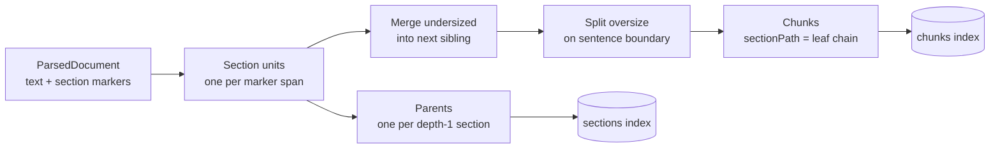

# 02 · Phase 2 Spec: Structural Chunking, Hybrid Retrieval, Embedding Ablation

- **Status**: Approved 2026-11-08
- **Scope**: ROADMAP §5 Phase 2. Builds on `00-overall-design.md` and `01-baseline.md`; does not repeat them.
- **Exit**: `evidence/phase2-chunking-retrieval.md` and `evidence/phase2-embedding.md` (the two
  comparison tables), produced from real eval-runner output. Results that contradict the
  expectation are recorded as they are.

---

## 1. What Phase 2 delivers

| # | Deliverable | Notes |
|---|---|---|
| 1 | `StructuralChunker` (`structural-v1-400-cl100k`) | SPM: by numbered paragraph. Markdown: by heading |
| 2 | `sections` index + `GET /v1/sections/{sectionId}` | Parent of each chunk; clearance-filtered; not embedded |
| 3 | BM25 leg + application-layer RRF (k = 60) | `mode` = `VECTOR` / `BM25` / `HYBRID` on `/v1/search` |
| 4 | Index selection by property | Lets one eval run target any chunker × model index (§6) |
| 5 | Eval runner: `--mode`, ablation driver | Six retrieval runs, then three embedding runs |
| 6 | Embedding adapter per-model prefixes | `nomic`, `bge-small`, `bge-m3` (§5) |
| 7 | Two evidence reports | §8 |

**Out of scope** (later): reranking, query rewriting, citation validation, refusal threshold,
audit, passing parent text to the `/v1/ask` prompt (Phase 3 decides, §3.3), fixture embeddings, CI.

## 2. Verification at the start of the Phase (ROADMAP §10)

Results are written into this section before implementation starts.

| Item | How | Result |
|---|---|---|
| ES `rrf` retriever licence on self-managed | Elastic subscription page + a live `POST _search` with an `rrf` retriever against a Testcontainers ES with the default (basic) licence | **Conflicting, unresolved.** Web sources (Elastic forum staff reply, user reports of a `403` licence error on 9.0.x Basic) say `rrf` needs an Enterprise-tier licence on self-managed. Live probe 2026-11-08 against `elasticsearch:9.5.5` (pinned digest, security on, no licence installed): an `rrf` retriever over a `match` and a `knn` retriever **succeeded**. `GET _license` returned an empty body, so the licence in force could not be read back. Conclusion: do not rely on it either way; the application-layer RRF decision stands |
| `bge-small-en-v1.5` and `bge-m3` available on the shared Ollama | `ollama pull` of the exact tag; `/api/embed` returns 384 / 1024 dims | Done 2026-11-08. `bge-m3:latest` (digest `790764642607`, F16) returns 1024 dims. `hf.co/CompendiumLabs/bge-small-en-v1.5-gguf:Q8_0` (digest `830b128269a5`, Q8_0; community GGUF import, no official Ollama tag) returns 384 dims. `nomic-embed-text` unchanged at 768. Author approved the pull. Note the bge-small weights are 8-bit quantised while the others are F16: a confound the ablation report must state |

**Whatever the licence result, RRF stays in the application layer** (ROADMAP §2: easier to
ablate and unit test). The check only settles the roadmap item.

Pulling models onto the shared Ollama changes shared state; the author approves it first.

## 3. Structural chunking

### 3.1 Units

The Phase 1 parsers already emit `SectionMarker`s (spec 01 §3.3), so structural chunking adds no
parsing. A **unit** is the text from one marker to the next marker (or end of document).

- **SPM**: every accepted numbered-paragraph marker starts a unit (`3.2.1` is its own unit).
- **Markdown**: a unit per numbered heading (`## 2 …`), since Markdown markers are headings only.
- Text before the first marker (front matter, `Structure` list) forms no chunk and is **not
  indexed**. Phase 1 indexed it under an empty path; dropping it is a deliberate change.

### 3.2 Merge and split

- `chunkerVersion = structural-v1-400-cl100k`; limits are properties: `max-tokens = 400`,
  `min-tokens = 60`.
- **Merge**: a unit below `min-tokens` is joined with the *following* unit if both share the same
  depth-1 parent; if it is the last unit of its parent, with the *preceding* one. The merged
  chunk's `sectionPath` is the first unit's path; `coveredSections` lists every unit's leaf
  number, so the Phase 1 scoring rule (spec 01 §3.4) still applies unchanged.
- **Split**: a unit above `max-tokens` is split into windows on sentence boundaries (`. ` +
  upper-case, or a line break), each ≤ `max-tokens`, with no overlap. A sentence longer than
  the limit becomes its own chunk. Split pieces share `sectionPath` and get consecutive `ordinal`s.
- No overlap between chunks: the structure supplies the boundaries, and the parent supplies context.
- Chunks never cross documents or depth-1 parents.
- The embedded text is the chunk `content` only. No title or section-path header is prepended
  (that would be a second variable in the ablation; Phase 4 may revisit).
- IDs, `contentHash`, `tokenCount`, `pages`: as Phase 1. `chunkerVersion` is part of `chunkId`
  (ROADMAP §4.2), so the two chunkers never collide.

`max-tokens = 400` for **all** embedding models, not only `bge-small`. With a 512-token limit
on `bge-small` and a tokenizer that differs from cl100k, 400 keeps it under the limit; using the
same chunks for all three models means the embedding ablation changes only the model.
The fixed chunker stays at 512/64, exactly as the baseline.

### 3.3 Parent–child

- **Parent = depth-1 section** of the document (`3`, not `3.2.1`), full text, one `sections`
  document per parent: fields per ROADMAP §4.1, `content` with the `english` analyzer.
  `sectionId = sha256(docId#<depth-1 path>)[:16]`.
- **Chunk `sectionId` points to its parent.** This amends Phase 1, where `sectionId` was derived
  from the chunk's own `sectionPath`. The chunk's `sectionPath` stays the leaf chain.
- Hits in `/v1/search` gain `sectionId`. `GET /v1/sections/{sectionId}` returns the parent
  (`docId`, `docTitle`, `sectionPath`, `pages`, `classification`, `content`), pre-filtered by
  clearance in the `ids`/`term` query; inaccessible and nonexistent both return `404`
  problem+json (spec 00 §4).
- The fixed-chunker index has no parents. `sections` is only built alongside structural indexes.
- **Not measured in Phase 2.** Retrieval metrics are chunk-level and parent expansion does not
  change them. Whether `/v1/ask` feeds parents or chunks to the model is a Phase 3 question
  (generation-side eval measures it). Phase 2 delivers and tests the mechanism.

## 4. BM25 leg and RRF

- **BM25 query**: `multi_match` over `content` and `docTitle`, `type: best_fields`, with a
  `bool.filter` on `classification` (pre-filter; ROADMAP §4.2). `docTitle` is included because
  several exact-term golden items name a module code (`OR-2`, `TM-G-2`) that header stripping
  removed from the body. Both fields use the `english` analyzer.
- **Vector leg**: unchanged (kNN, `num_candidates` property, classification filter).
- **Candidate depth**: each leg returns `rag.retrieval.leg-size` (default 50) hits.
- **RRF** in `core`, pure: `score(d) = Σ 1 / (60 + rank_leg(d))` over legs where `d` appears.
  Sort by score desc; ties broken by best single-leg rank, then `chunkId` (deterministic).
  Output truncated to `topK`.
- `mode`: `VECTOR` / `BM25` / `HYBRID`, default `HYBRID` from Phase 2 on. `BM25` makes no
  embedding call. `scores` on a hit: `{vectorRank, bm25Rank}` (absent when the leg did not
  return it), plus raw `similarity` / `bm25Score` for the leg that did. `rerank: true` is still `400`.
- If one leg returns nothing, `HYBRID` returns the other unchanged.
- If Ollama is down, `BM25` still works and `HYBRID` fails with the `503` of Phase 1; it does
  **not** silently degrade to BM25, because that would make eval numbers lie.

## 5. Embedding models

| Model | Dims | Query prefix | Document prefix | Index name segment |
|---|---|---|---|---|
| `nomic-embed-text` | 768 | `search_query: ` | `search_document: ` | `nomic768` |
| `bge-small-en-v1.5` | 384 | `Represent this sentence for searching relevant passages: ` | none | `bgesmall384` |
| `bge-m3` | 1024 | none | none | `bgem3-1024` |

Prefixes, dims and model id become `rag.embedding.models.<name>` properties; the adapter takes
them from config instead of constants. The exact Ollama tags are fixed during §2 verification.
Embedding cache key already includes the model, so the three caches do not interact.

Index names: `<prefix>-chunks-<model><dims>-<chunker>-v1`, e.g.
`rag_dev-chunks-nomic768-struct400-v1`, `rag_dev-sections-struct400-v1`. The alias `<prefix>-chunks`
points at whichever index the author promotes; see §6 for how experiments avoid touching it.

## 6. Selecting an index for an experiment

New property `rag.retrieval.chunks-index` (env `RAG_CHUNKS_INDEX`), default the alias.
`rag.retrieval.sections-index` likewise. The ablation script starts the app once per index
with these set, so the **API contract does not grow an index parameter**. Ingest gets
`--chunker=fixed|structural` to build each physical index; the embedding model is the process's
`RAG_EMBEDDING_MODEL` (the embedder is one injected bean, so a `--model` flag would only duplicate
it). Ingest moves no alias unless `--promote` is passed; this changes Phase 1, where every ingest
moved the alias.

`/actuator/info` already reports `chunkerVersion` and `embeddingModel` from the live index
`_meta`; the runner records them, so every report states which index it measured.

## 7. Eval runner and ablation

- Runner gains `--mode=VECTOR|BM25|HYBRID` (default `HYBRID`). The `mode` is recorded in the report.
- `scripts/run-ablation.sh` drives the experiments, writes nothing but run directories, and
  refuses to start if the working tree is dirty (the report records the commit).
- **Retrieval ablation** (table 1): `{fixed-512-64, structural-400}` × `{VECTOR, BM25, HYBRID}`
  with `nomic`: six runs, each broken down by `category`, for `test` and `dev`.
- **Embedding ablation** (table 2): `HYBRID` + structural, `{nomic, bge-small, bge-m3}`. For each:
  Recall@5, Recall@10, MRR, nDCG@10 (all categories and `exact-term`), embed-step wall time on
  an empty cache, chunks, index size, `/v1/search` p50/p95.
- Scoring unchanged from spec 01 §3.4, so Phase 1 numbers stay comparable. The Phase 1 baseline
  row (`fixed`, `VECTOR`) is **re-run** in the same session rather than copied, to keep
  conditions identical; any difference from the committed baseline is stated.
- **Small n**: `test` has 10 scored items (2 `exact-term`). Tables show `n` next to every number,
  and the report says that differences of a single item are not evidence. `dev` (n = 26) is
  the primary basis for comparison; thresholds are never tuned on `test` (spec 00 §11).

## 8. Evidence reports

1. `evidence/phase2-chunking-retrieval.md`: configuration (versions, commit, machine, §2
   verification results), chunk counts and token statistics per chunker, the 6-run table
   per category, per-item ranks for items that changed against the baseline, observations.
2. `evidence/phase2-embedding.md`: the embedding table (§7) and observations on small vs large
   model, including whether the gap justifies the ingest time.

Observations are written only from the numbers. The expectation (hybrid wins on `exact-term`;
structural ≥ fixed on Recall@5) is stated up front and then confirmed or contradicted.
Per-item rows show ids and ranks, never chunk text.

## 9. Testing

| Layer | What | How |
|---|---|---|
| `core` unit | Structural chunker: unit boundaries from markers, merge into next sibling / previous when last, split on sentences, oversize sentence, no cross-parent chunks, front matter dropped, `coveredSections` after merge, determinism (same input → same IDs), Markdown headings. RRF: hand-computed fusion, a doc in one leg only, tie-breaking, empty leg, `k` | JUnit 5, self-made text; the PDF is generated in-test as in Phase 1 |
| `app` integration | `sections` + `chunks` mapping and `_meta`; `BM25` and `HYBRID` through `/v1/search`; **permission pre-filter on the BM25 leg** (a `PUBLIC` principal never receives an `internal` hit even when it is the only lexical match); `GET /v1/sections/{id}` returns parent, `404` for inaccessible and unknown ids alike; `mode=BM25` works with the embedder failing; `HYBRID` returns `503` with the embedder failing | Testcontainers ES (limits as Phase 1) + fake `Embedder` |
| Adapter | Per-model prefixes and dims from config | Stub HTTP server |
| Eval runner | `--mode` plumbing and report field | Stub server |
| Scripts | `run-ablation.sh` refuses a dirty tree | Bash test beside `scripts/tests/` |

## 10. Decisions made by Claude in this spec (for author review)

1. Parent = depth-1 section; chunk `sectionId` now points to it (§3.3).
2. `max-tokens = 400`, `min-tokens = 60`, merge-into-next rule, no overlap (§3.2).
3. Chunk text is embedded without a title/path header (§3.2).
4. Front matter / `Structure` text is not indexed by the structural chunker (§3.1).
5. BM25 searches `content` and `docTitle`, not `content` alone (§4).
6. `leg-size = 50`; RRF tie-break rule; `HYBRID` is the default mode (§4).
7. No fallback from `HYBRID` to `BM25` when Ollama is down (§4).
8. All embedding models share the 400-token structural chunks, so only the model varies (§3.2).
9. Parent expansion in `/v1/ask` deferred to Phase 3; Phase 2 does not measure it (§3.3).
10. Experiments select an index by property + `--promote`, not by an API parameter (§6).
11. The Phase 1 baseline row is re-run, not copied (§7).
