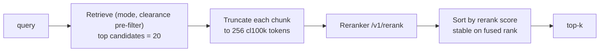
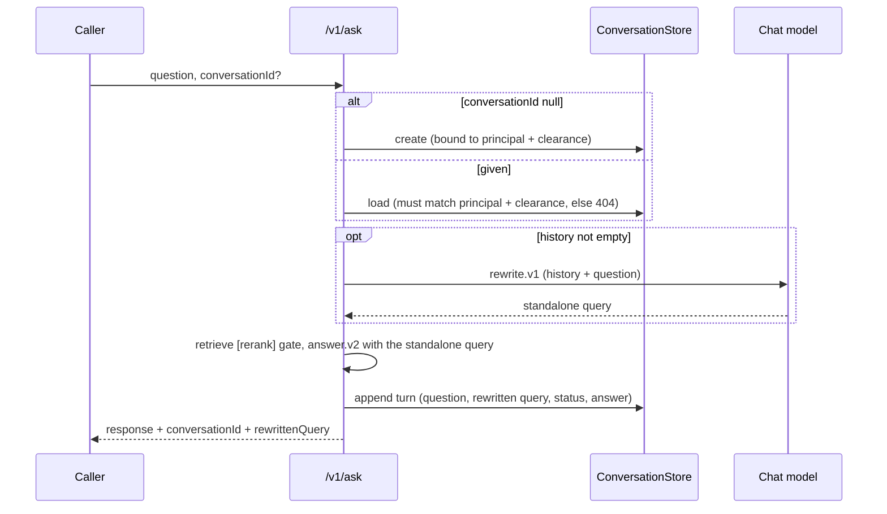

# 04 · Phase 4 Spec: Rerank and Query Rewriting

- **Status**: Approved 2026-11-09 (§10 item 1: option (a))
- **Scope**: ROADMAP §5 Phase 4. Builds on `00-overall-design.md` to `03-generation.md`; does not repeat them.
- **Exit**: `evidence/phase4-rerank.md` with "rerank takes Recall@5 from X to Y and adds Z ms of p95 latency",
  and `evidence/phase4-rewrite.md` with the multi-turn result, both from real runner output. The decision on the
  trade-off goes in `decisions/04-rerank.md`, written by the author.

---

## 1. What Phase 4 delivers

| # | Deliverable | Notes |
|---|---|---|
| 1 | Reranker sidecar | arm64, CPU only, one service with CPU and memory limits (§3) |
| 2 | `rerank: true` on `/v1/search` and `/v1/ask` | Top-20 candidates, each truncated to 256 tokens → cross-encoder → top-k (§4) |
| 3 | Rerank-score refusal gate | Separate property; swept on `dev` like spec 03 §3.2 (§5) |
| 4 | `conversationId` on `/v1/ask` | Server-side history, bound to the principal; LLM rewrites the follow-up into a standalone query (§6) |
| 5 | Multi-turn eval set + runner mode | Follow-ups built on existing golden items (§7.2) |
| 6 | Eval runs and evidence | Rerank on/off × two reranker models; rewrite on/off (§7) |

**Out of scope**: audit persistence (Phase 5; the rewritten query is returned and logged now and persisted in Phase 5),
observability spans (Phase 5), contextual chunk headers, rerank in CI (PR CI has no reranker; §8).

## 2. Verification at the start of the Phase (ROADMAP §10)

Checked 2026-11-09 (plan Task 1). The llama.cpp route failed for MiniLM, and the author chose the Python sidecar
for both models (§3).

| Item | How | Result |
|---|---|---|
| llama.cpp server image on arm64 | `docker buildx imagetools inspect` | `ghcr.io/ggml-org/llama.cpp:server-b11889` (2026-10-25) is multi-arch with `arm64`. Tried, then dropped (below) |
| MiniLM GGUFs in llama.cpp b11889 | Load and score the parity pairs | **Fail.** `cstr/ms-marco-MiniLM-L-6-v2-GGUF` (F32, rev `1a9ef5c`) does not load ("bert model needs to define token type count"). `sinjab/…-F16-GGUF` (rev `056fdac`) and `keisuke-miyako/…-gguf-f16` (rev `66a5cbb`) load but return the same near-constant scores (−0.02 to −0.10) where the reference logits are about ±10; top-1 wrong on 3 of 5 queries. llama.cpp does not apply this model's classification head |
| bge-reranker-v2-m3 GGUF in llama.cpp | Parity pairs | Pass (`gpustack/bge-reranker-v2-m3-GGUF` FP16, rev `3093af0`): Spearman 1.000 on all 5 queries, max abs logit difference 0.63. About 55 s for 20 passages of about 280 tokens on 2 threads |
| Python sidecar base | `docker buildx imagetools inspect python:3.12-slim` | Multi-arch index `sha256:5e2bdb1b…`; `torch==2.9.1` (CPU wheel index) and `sentence-transformers==5.1.2` install on aarch64 |
| **Score parity** of the sidecar against `sentence-transformers` `CrossEncoder` | `scripts/rerank-parity/run.sh minilm|bge`: 5 self-made queries × 4 passages | Pass for both models, max abs difference 0.0000 (same weights, same library; the check confirms the HTTP path and index mapping) |
| Response shape | One live call | `{"model", "results": [{"index", "relevance_score"}]}`, raw logits, sorted descending, `index` refers to the input order |
| Cold start, RSS, latency (2 CPUs) | `docker stats`; 20 passages of about 280 cl100k tokens, 3 calls | MiniLM: ready in 21 s (weights cached after the first start), 333 MiB, **about 1.95 s** per call. bge-reranker-v2-m3: ready in 49 s, 1.87 GiB, **about 54 s** per call. Synthetic passages; real chunks are shorter (median 108 tokens), so §7 measures the real figures |

## 3. Reranker sidecar

**Choice: a Python sidecar (ROADMAP §7.1 option b) for both models.** Chosen by the author on 2026-11-09 after the
llama.cpp route failed parity for MiniLM (§2).

- `reranker/server.py`: standard-library HTTP server, `sentence-transformers` `CrossEncoder` with
  `activation_fn=Identity` (raw logits), `max_length=512`, `torch.set_num_threads(2)`. `POST /v1/rerank`
  `{"query", "documents", "top_n"}` → `{"model", "results": [{"index", "relevance_score"}]}`; `GET /health`.
- `reranker/Dockerfile`: `python:3.12-slim` pinned by digest, `torch==2.9.1` (CPU wheel index), `sentence-transformers==5.1.2`.
- Official weights from Hugging Face, pinned by revision: `cross-encoder/ms-marco-MiniLM-L6-v2` @ `233902d2` (default),
  `BAAI/bge-reranker-v2-m3` @ `953dc6f6`. Selected with `RERANKER_MODEL` / `RERANKER_REVISION`, cached in the
  `reranker-models` volume, not in git.
- Service: `reranker` in `compose.yaml`, profile `rerank`, loopback port 18090, limits **2 CPUs / 1 GB**
  (ROADMAP §7). For the `bge-reranker-v2-m3` comparison run memory is raised to 3 GB (`RERANKER_MEMORY=3G`) for that
  run only, recorded in the evidence report.
- Runs on the development server from this repo's compose (§10 item 1, option a).

## 4. Rerank in the retrieval path

- **Request**: `rerank: true` is accepted on `/v1/search` and `/v1/ask` (currently `400`). Default stays `false`;
  whether the default changes is the author's decision (§9).
- **Candidates**: `rag.rerank.candidates = 20` from the requested mode (normally `HYBRID`), **after** the clearance
  pre-filter, so the reranker only ever sees documents the caller may see. If `topK > candidates`, candidates = `topK`.
- **Truncation**: each candidate text is cut to `rag.rerank.max-passage-tokens = 256` with the existing `cl100k`
  `TokenCounter`, at a token boundary. The full chunk text is still what `/v1/search` returns and what the answer prompt
  receives; truncation is only for the reranker input. The query is not truncated (the request already limits it).
- **Ordering**: sort by rerank score descending; ties keep the fused order. Each hit keeps its existing `scores` and
  gains `rerankScore` (raw logit), `rerankProbability` (`sigmoid(logit)`) and `fusedRank`. `score` becomes
  `rerankProbability` when reranked.
- **Failure**: reranker unreachable, timeout (`rag.rerank.timeout = 5s`) or malformed response → `503`
  problem `reranker-unavailable`. No silent fallback to the fused order, same rule as a failing leg (spec 02 §4).
- **Latency**: `latencyMs.rerank` on `/v1/ask` is now measured; `/v1/search` gains `diagnostics.latencyMs`
  `{retrieval, rerank}` so the eval runner can report server-side stage latency as well as client-side total.
- Client: plain `RestClient` (Spring), no Spring AI abstraction, since the endpoint is not a chat or embedding model.

## 5. Rerank-score refusal gate

- New property `rag.ask.min-rerank-probability`, default `0.0` (off), applied **only when `rerank: true`**, on the
  best `rerankProbability`. The vector-similarity gate (`decisions/03`, currently off) is unchanged and independent.
- Probability rather than raw logit so the existing 0.00–1.00 sweep grid applies to both models. Logits are monotonic
  in probability, so ranking and refusal decisions are identical either way.
- `eval-runner --sweep --rerank=true` writes the same table as spec 03 §3.2 against `rerankProbability`. `dev` only;
  `test` is evaluated once at the chosen value.
- Expectation stated now: a cross-encoder score separates answerable from unanswerable better than bi-encoder cosine
  (which sat in 0.65–0.85 for both), and should hurt `exact-term` less. Measured, not assumed; `dev` still has only
  4 unanswerable and 5 restricted items.
- The value is the author's, recorded in `decisions/04-rerank.md`. Gate refusals keep the external reason
  `LOW_RETRIEVAL_SCORE`.

## 6. Multi-turn: `conversationId` and query rewriting

### 6.1 Conversation store

- In memory (`ConcurrentHashMap` with expiry), no new middleware. Limits as properties: `rag.conversation.ttl = 30m`
  idle, `max-turns = 5` kept (oldest dropped), `max-conversations = 1000` (oldest evicted). Lost on restart; stated in
  the README. A persistent store is not needed for a demo service and would add a datastore that needs its own
  prod/dev pools.
- `conversationId` is server-generated (`cv_` + ULID like `answerId`). A client-supplied unknown id → `404`.
- **Bound to the principal name and clearance**. Another principal using the id gets the same `404` as an unknown id,
  so a caller cannot learn that a conversation exists. History holds earlier answers, which may contain content only the
  owner may see; this binding is what keeps it from crossing callers.
- A refused turn is stored with its question and `status`, no answer text.

### 6.2 Rewriting

- Only when history is non-empty: the first turn makes no extra model call.
- Prompt `prompts/rewrite.v1.st`: last `max-turns` turns (question + answer, answers truncated to 300 tokens each)
  wrapped as data like `answer.v2` sources, then the follow-up; "rewrite the follow-up into one standalone search query;
  resolve pronouns and references from the history; do not answer it; output only the query". Same chat model as
  answering, temperature 0, `max-tokens 128`.
- The standalone query is used for **retrieval and for the answer prompt** (answer.v2 is unchanged; it sees the
  standalone question, not the history). This keeps citations and refusals exactly as in Phase 3.
- Output sanity: trimmed, one line; empty or longer than 512 chars → use the original question and log it. The
  rewrite never widens access: retrieval still runs under the caller's pre-filter.
- Response gains `conversationId` and `rewrittenQuery` (null on a first turn). `usage` sums the rewrite and answer calls;
  `latencyMs` gains `rewrite`. The rewritten query is logged at `INFO` with the `answerId` until Phase 5 writes it to
  `rag-audit` (ROADMAP §4.3 already has the field).
- `/v1/search` gets no conversation support; it is a stateless retrieval endpoint.

## 7. Evaluation

### 7.1 Rerank (retrieval side, no LLM tokens)

Fixed: structural chunks, `nomic-embed-text`, `HYBRID`, same index and corpus as Phase 3. Runs, `dev` and `test`:

| Run | Reranker |
|---|---|
| A | none (Phase 2/3 configuration, re-run in the same session for latency comparability) |
| B | `ms-marco-MiniLM-L-6-v2` |
| C | `bge-reranker-v2-m3` (memory raised per §3) |

- Metrics: Recall@5, MRR, nDCG@10 per category and split (spec 01 §3.4 scoring, unchanged); eval `topK = 10`
  so nDCG@10 is defined, candidates 20.
- **Latency**: each run repeats the full item list **3 times**; report p50/p95 of client-side total and of
  server-side `rerank` stage over all repetitions (n = items × 3), with the first repetition also reported alone as
  the cold run. Shared host, stated.
- The headline sentence uses `test` Recall@5 for B vs A, and the p95 difference of the server-side `retrieval + rerank`
  stages. With `n = 10` on `test`, one item is 0.1; the report says so.

### 7.2 Multi-turn set

- New file `eval/multi-turn.yaml`. Each item: `{id, split, turns: [goldenId], followUp, expectedSources, minClearance}`.
  The first turn is an **existing golden item** (its question is asked live); the follow-up is a question that only
  makes sense with that context, e.g. after g001 ("severity levels"): "How soon must the CIO hear about the highest
  one?" with g002's expected sources.
- About 12 items (8 `dev`, 4 `test`), mostly built from pairs of existing golden items so `expectedSources` are reused
  from author-approved data. **I draft; the author reviews and commits** (golden data is author-owned, CLAUDE.md).
- Runner `--multi-turn=true`: per item, ask turn 1 with a new conversation, then the follow-up three ways:
  (i) follow-up **without** a conversation (raw, lower bound), (ii) follow-up **with** the conversation (rewrite),
  (iii) the follow-up's golden standalone question (upper bound). Report Recall@5 / MRR of the follow-up retrieval for
  each, plus the rewritten queries' ids only (rewritten text may quote SPM-derived answers → kept in `eval/runs/`).
- Costs tokens (turn 1 answer + rewrite + follow-up answer): about 36 model calls for 12 items. Run once per split.

### 7.3 Generation with rerank (optional)

If rerank is adopted, one `dev` `--generation` run with `rerank: true` to check that faithfulness and false refusal do
not regress, especially multi-hop (Phase 3 observation 2). Recorded either way; skipped is stated.

## 8. CI

PR CI has no reranker and runs retrieval-side eval without rerank (ROADMAP §8, Phase 5 builds it). If rerank becomes
the default, the CI baseline is still the no-rerank configuration and the report says so; adding a reranker container to
CI is a Phase 5 question.

## 9. Evidence and decision

- `evidence/phase4-rerank.md`: configuration (images, digests, GGUF files and sha256, limits), parity check result,
  metrics table A/B/C, latency table, rerank-score sweep table, optional §7.3 run, observations written from the numbers.
- `evidence/phase4-rewrite.md`: multi-turn table (raw / rewrite / standalone), tokens and latency added by the rewrite,
  failures by item id.
- `decisions/04-rerank.md`: **author-written** (I may draft from runner output, as for `decisions/03`): adopt rerank
  as default or not, which model, and the rerank gate value. ROADMAP Phase 4 is ticked only after it exists.

## 10. Calls I made, and points for you to confirm

1. **Reranker hosting on the development server.** The dev server uses shared ES and Ollama stacks owned by the gitops
   repo and does not start this `compose.yaml`. Options: (a) start only the `reranker` service from this repo's compose
   on the dev server (project-owned, lives and dies with Phase 4 experiments); (b) ask gitops for a shared reranker
   stack. **I propose (a)**: only this project uses it, and the comparison run changes its memory limit. Either way the
   compose service exists so others can run it.
2. **Reranker runtime.** Drafted as llama.cpp first; it failed MiniLM parity and the author chose the Python sidecar for both models (§2, §3).
3. **Gate on `sigmoid(logit)`**, a separate property, applied only with `rerank: true` (§5).
4. **Rewritten query feeds both retrieval and the answer prompt**; the answer prompt never sees history (§6.2).
5. **In-memory conversation store**, bound to principal + clearance, `404` for both unknown and foreign ids (§6.1).
6. **Rewrite uses the generation model** (`deepseek-flash`), not a separate small model.
7. **Multi-turn set built from existing golden items**, drafted by me, committed by you (§7.2).
8. **Rewritten query is returned and logged now, persisted in Phase 5** (ROADMAP says "write to the audit log", which
   does not exist until Phase 5).
9. **Latency from 3 repetitions** per run on a shared host; no attempt to isolate the host.

## 11. Testing

| Layer | What | How |
|---|---|---|
| `core` unit | Truncation at 256 cl100k tokens; stable rerank ordering with ties; sigmoid | JUnit 5 |
| `app` unit | Rerank client: response parsing by index, malformed body, timeout → `reranker-unavailable`; rewrite output sanity (empty, multi-line, too long → original question) | JUnit 5 + stub HTTP server |
| `app` unit | `ConversationStore`: TTL expiry, max-turns trimming, max-conversations eviction, foreign principal and changed clearance → not found | JUnit 5 with a fake clock |
| `app` integration | `rerank: true` reorders by stub scores and only sends pre-filtered candidates (a `public` caller's reranker request contains no `internal` chunk); reranker down → `503`; rerank gate refuses without a chat call; first turn makes one chat call, follow-up two; foreign `conversationId` → same `404` body as unknown; `rerank: false` behaviour byte-identical to Phase 3 | Testcontainers ES (limits as before) + stub reranker server + `StubChatModel` |
| Eval runner | `--rerank` flag passthrough; repetition latency percentiles; multi-turn three-way scoring on hand-made results; reports carry ids only | JUnit 5 |
| Compose | `check-compose-limits.sh` passes with the new service | Existing script |

## 12. Work order (for the plan)

1. Verification (§2): reranker sidecar, parity check, response shape; `compose.yaml` service. Fill §2.
2. Core: truncation and ordering helpers (TDD).
3. Rerank client + `HybridSearch`/search path + `/v1/search` diagnostics + `/v1/ask` rerank + rerank gate.
4. Eval runner: `--rerank`, repetitions, rerank sweep.
5. Runs A/B/C, sweep; draft evidence; author writes `decisions/04`.
6. Conversation store, `rewrite.v1`, `/v1/ask` multi-turn.
7. Multi-turn set (draft → author) and runner mode; run; evidence.
8. Optional §7.3; tick `ROADMAP.md` (Phase 4 boxes and the §10 reranker verification item).

The detailed plan goes in `04-rerank-rewrite-plan.md` after you approve this spec.
